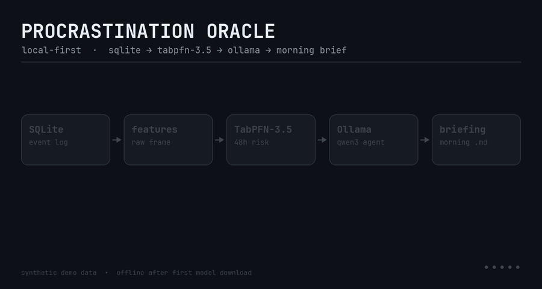

# Procrastination Oracle

A local-first app that predicts which of your todos you will skip, then acts
before you have to.

**SQLite event log → raw features → TabPFN-3.5 → Ollama agent → `morning_briefing.md`**

No cloud database, no hosted inference, no task content leaving the machine
after the one-time model download. Two MCP tools expose the same brain to
Claude Desktop.

> The demo uses a generated procrastinator. Every synthetic row is tagged
> `source='synthetic'`, the CLI prints a warning, and the briefing carries a
> banner. Do not mistake demo predictions for a portrait of you.



---

## Why this exists

Knowing that you *might* skip something is not useful. Knowing **which** task
you will skip, **when** you actually finish things, and having the first step
already drafted is useful. The Oracle closes that loop:

1. **Log** every task's created/due/completed timestamps in SQLite.
2. **Predict** `P(not completed within 48h)` with TabPFN-3.5 on raw features.
3. **Intervene** by risk tier — three tiny subtasks (HIGH), reschedule to your
   best slot (MED), or a two-minute first step (LOW).
4. **Brief** you in two lines plus a table, with the interventions already taken.

---

## Quickstart (synthetic user, ~2 minutes)

```bash
git clone <this-repo> && cd procrastination-oracle
uv venv && source .venv/bin/activate        # Python 3.10+
uv pip install -e ".[dev]"

cp .env.example .env
# One-time TabPFN-3.5 license acceptance:
#   https://ux.priorlabs.ai → Licenses → copy API key → TABPFN_TOKEN=... in .env

python scripts/init_db.py
python scripts/generate_synthetic.py          # 400 clearly-labeled fake tasks
python scripts/train_and_eval.py              # <-- the metrics table
python scripts/run_nightly.py                 # writes morning_briefing.md
```

Optional local agent (otherwise deterministic fallbacks are used):

```bash
ollama serve
ollama pull qwen3
```

**Everything is offline after the first TabPFN weight download.** The fitted
classifier is saved to `models/oracle_tabpfn_v3_5.joblib`; nightly runs load
that file and never touch the network.

### Plain pip

```bash
python -m venv .venv && source .venv/bin/activate
pip install -e ".[dev]"
```

---

## Architecture

```
 Todoist API / synthetic generator
              │
              ▼
      oracle.db (SQLite)                 task_events + interventions + runs
              │
              ▼
      features.py                        raw title/category strings,
              │                          numbers, missing values — no scaling,
              ▼                          no one-hot, no vectorisation
   TabPFN-3.5 classifier                 P(completed within 48h)
              │
              ▼
   risk tiers: HIGH / MED / LOW
              │
              ▼
   Ollama agent (qwen3)                  break into 3 / reschedule / 2-min step
              │  (deterministic fallback if Ollama is down)
              ▼
   morning_briefing.md                   two lines, risk table, actions taken
```

* **One row per task.** Features are observable at scoring time; `completed_at`
  and `deleted_at` never enter the feature frame.
* **Chronological split.** The last 25% of tasks by creation time are the test
  set. Never shuffled, never random.
* **No preprocessing for TabPFN.** `title` stays a raw string, `category` stays
  a raw string, missing deadlines stay `NaN`. The logistic baseline does the
  conventional TF-IDF/one-hot/scaling work so the comparison is fair.
* **Time is measured at one `as_of` snapshot** for all rows, matching inference.

### Risk tiers

| Tier | Risk | Action |
| --- | --- | --- |
| HIGH | ≥ 0.60 | break into 3 subtasks of ≤ 15 minutes |
| MED | 0.30 – 0.60 | reschedule to the weekday/hour you actually complete things |
| LOW | < 0.30 | draft the first two-minute step |

The agent takes at most 6 interventions per night (`--max-interventions`), so
the briefing stays readable. Every action is written to the `interventions`
table with its source (`llm` or `fallback`).

---

## The money output

```bash
python scripts/train_and_eval.py
```

```
==========================================================================
PROCRASTINATION ORACLE — model comparison
==========================================================================
Tasks: 397   train: 298   test: 99
Train window: 2026-06-26 → 2026-09-25
Test window:  2026-09-25 → 2026-10-21
Label rate: train 0.26 / test 0.35   (split is chronological, never random)
TabPFN input: raw DataFrame (8 columns, no scaling/encoding)

Model                   Accuracy     AUC   Brier   Notes
------------------------------------------------------------
TabPFN-3.5              not run       —       —   needs TABPFN_TOKEN (one-time license)
Logistic regression       0.667   0.764   0.200   tf-idf + one-hot + scaled
Majority class            0.646   0.500   0.237   always predicts 0 (train prevalence 0.26)

Test set: 99 tasks, 35 positives (35%); chronological split, no shuffling.
```

That block is the real baseline output from the reference run of this repo.
It was built in a headless environment without a license token, so the TabPFN
row is marked **not run** rather than filled with invented numbers. Once
`TABPFN_TOKEN` is set, the same command prints the full three-way table; the
script also writes `models/eval_metrics.json` with
`"unavailable": ["TabPFN-3.5"]` when the weights cannot be loaded.

**Reading the table**

* **Accuracy** — thresholded at 0.5. Majority class is a strong baseline when
  skips are rare; always check it.
* **AUC** — ranking quality, independent of threshold. 0.5 is a coin flip.
* **Brier** — mean squared error of the probabilities. Lower is better; this is
  the calibration check that matters for a risk-tier system.

### TabPFN setup

TabPFN-3.5 weights are license-gated. Accept once, then run offline:

1. Open <https://ux.priorlabs.ai>, log in, accept the license.
2. Copy the API key from the account page.
3. Put `TABPFN_TOKEN=<key>` in `.env`.
4. Run `python scripts/train_and_eval.py` once to download and cache the weights.

CI/headless is supported with the same environment variable. The token is only
needed for the download; `run_nightly.py` afterwards works with no network.

---

## Data

### Synthetic generator

`scripts/generate_synthetic.py` builds ~400 tasks over 120 days with a fixed
seed. It is deterministic and deliberately lopsided:

* **`Call the dentist about the filling`** — deferred 9×, never completed.
* **`Coffee with Sam`** — 12 weekly instances, all completed on time.
* Deadlines create a small urgency bump; overdue tasks get worse.
* Social plans finish fast; admin and creative work rot.
* Some tasks are still open when their 48-hour label window has not elapsed —
  those rows are excluded from training, because their label is unknowable.

### Todoist

```bash
# .env: TODOIST_API_TOKEN=...
python scripts/ingest_todoist.py --since-days 90
```

Pulls active tasks plus completed tasks from the last 90 days. Honest
limitations, spelled out in `src/collectors/todoist.py`:

* Todoist has no deferral counter, so imported tasks start at `deferred_count=0`.
* All-day due dates become 17:00 UTC (the API omits the user's timezone).
* Completed tasks without `added_at` are skipped rather than given a fabricated
  creation time that would poison the 48h label.

Use **one** data source per database. The briefing warns whenever any synthetic
row is present.

### The label

```
completed_within_48h = 1  if completed_at - created_at <= 48h
                       0  if completed/deleted after that, or the window elapsed
                       excluded while the window is still open
```

---

## MCP server

Two read-only tools for Claude Desktop and other FastMCP clients:

* `predict_task_risk(tasks_csv)` — CSV text with `title` plus optional
  `category`, `due_at`, `created_at`, `deferred_count`, `task_id`.
* `get_my_patterns()` — 48h completion rate, per-category and per-weekday rates,
  most-deferred tasks, and the best completion slot.

```bash
python src/mcp_server.py          # stdio
```

Claude Desktop config:

```json
{
  "mcpServers": {
    "procrastination-oracle": {
      "command": "/absolute/path/to/.venv/bin/python",
      "args": ["/absolute/path/to/src/mcp_server.py"],
      "env": { "ORACLE_DB": "/absolute/path/to/oracle.db" }
    }
  }
}
```

Example CSV:

```csv
title,category,due_at,deferred_count
Call the dentist,health,2026-10-25,9
Buy milk,errands,,0
```

---

## Nightly run without infrastructure

```bash
python scripts/run_nightly.py
```

This is the fallback path and the reference implementation:

1. optional Todoist sync (`--sync-todoist`)
2. score open tasks with the saved model
3. ask Ollama for tier-specific interventions (or use fallbacks)
4. persist interventions + run metadata to SQLite
5. write `morning_briefing.md`

Useful flags: `--db`, `--model`, `--out`, `--max-interventions`, `--no-llm`,
`--no-synthetic`, `--sync-todoist`.

If Ollama is not running, the run still succeeds and the briefing labels every
action `heuristic fallback`. It never pretends an LLM wrote the text.

---

## Temporal (optional, last)

```bash
uv pip install -e ".[temporal]"
temporal server start-dev                     # terminal 1

python -m workflow.nightly --schedule         # terminal 2: worker + 21:00 cron
python -m workflow.nightly --once             # terminal 3: run immediately
```

The schedule defaults to `0 21 * * *` in UTC; set `ORACLE_TZ` (IANA name) or
`--timezone` for local time. Activities are `sync → predict → intervene → brief`
and reuse the same libraries as the standalone CLI. Nothing in
`scripts/run_nightly.py` imports `temporalio`.

---

## Tests

```bash
pytest
```

* `test_features.py` — labels, unresolved rows, raw columns, time split.
* `test_synthetic.py` — determinism, signature behaviors, no label leakage.
* `test_oracle.py` — fit/predict/save/load roundtrip on a 50-row sample, plus
  wrapper tests that do not need model weights.

The real TabPFN roundtrip test is **skipped** on a machine without the license
token/model cache; its skip message says so. Everything else runs offline.

---

## Project layout

```
src/
  db.py                     SQLite schema + event/intervention storage
  collectors/synthetic.py   clearly-labeled fake procrastinator
  collectors/todoist.py     real Todoist sync
  features.py               raw feature frame, label, time split, patterns
  oracle.py                 TabPFN-3.5 wrapper + open-task scoring
  baselines.py              logistic + majority + metric table
  agent/llm.py              Ollama client
  agent/interventions.py    HIGH/MED/LOW actions, validation, fallbacks
  briefing.py               morning_briefing.md renderer
  mcp_server.py             FastMCP tools
  workflow/                 optional Temporal activities + nightly workflow
scripts/                    init, ingest, generate, train_and_eval, run_nightly
tests/
```

---

## Limitations

* **48 hours is a design choice**, not a truth. Change `LABEL_WINDOW` in
  `features.py` and retrain.
* `deferred_count` is a snapshot, not a time series. Historical rows use the
  count as recorded, which is the best the schema supports.
* The synthetic user is fake. Metrics on it are a smoke test, not evidence
  about your life.
* TabPFN-3.5 weights are non-commercial-licensed. Check the license for your use.
* The Oracle predicts and writes; it does not modify Todoist. You stay in control.

---

Built to be run at 9pm so that 9am has fewer decisions.
